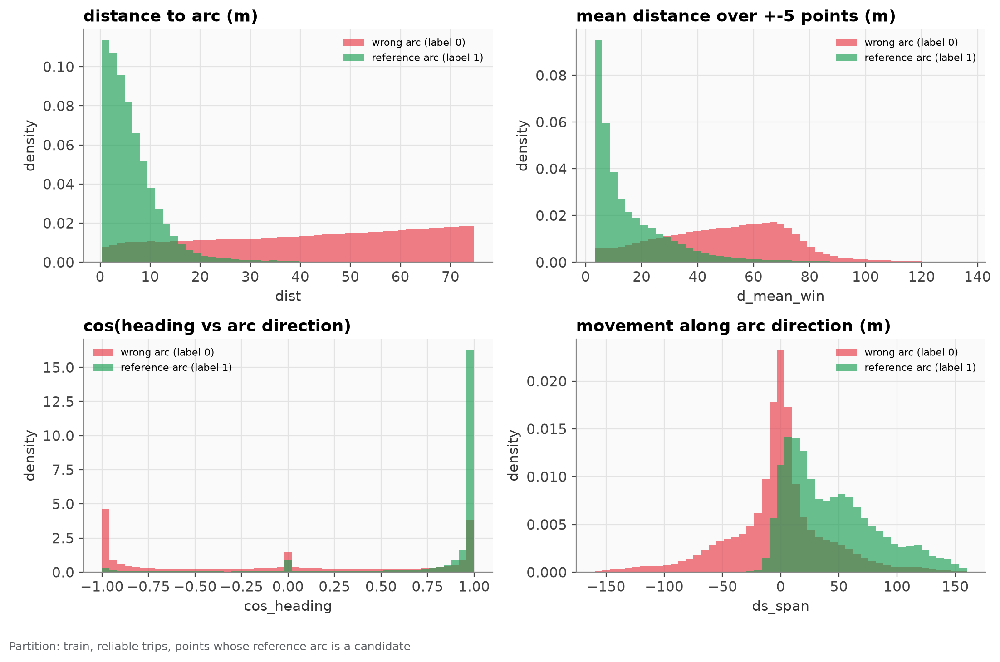
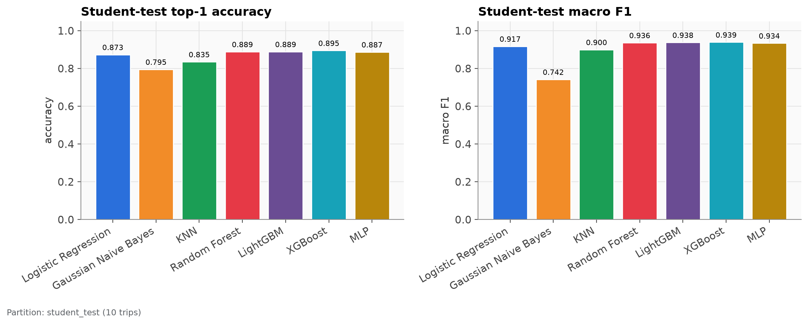
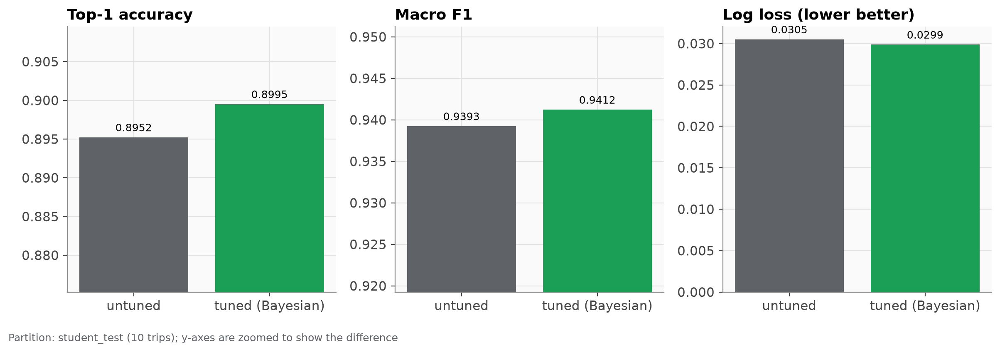
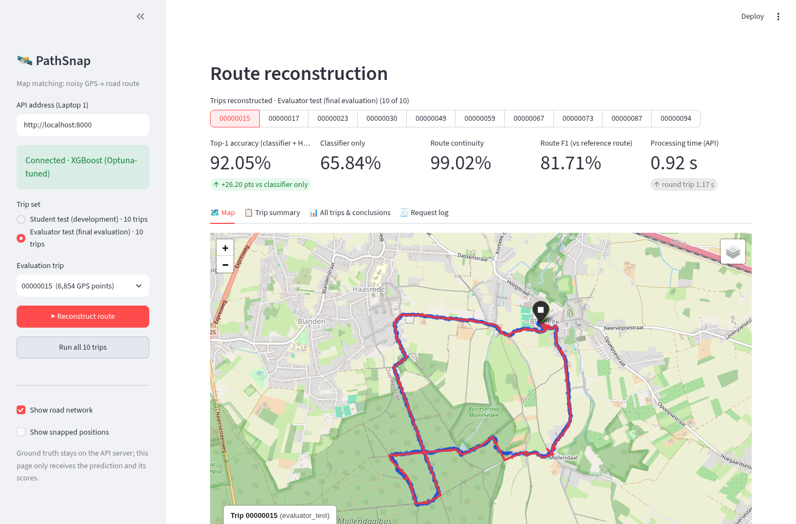
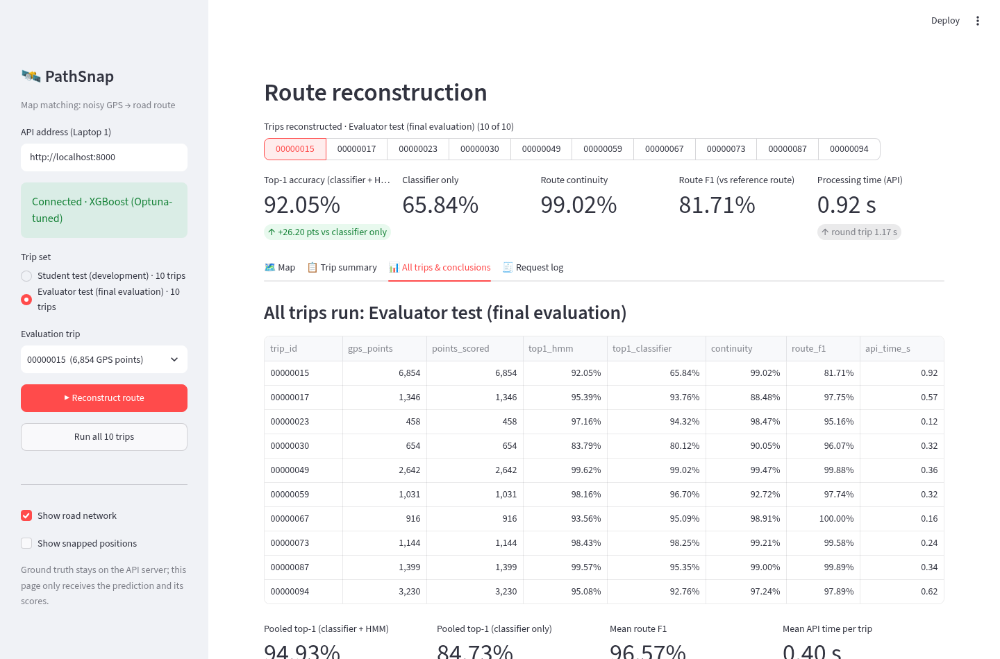
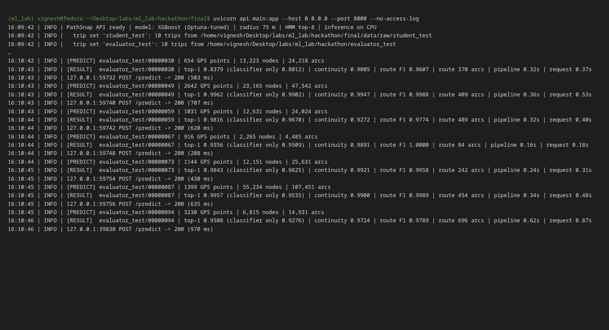

# Problem and approach

Each trip consists of a GPS trajectory (`.track`: longitude, latitude, time), a road network (`.nodes` with coordinates; `.arcs` as directed node pairs whose row index is the arc id) and, where supplied, the reference route (`.route`: arc ids in travel order). The task is to return the road arc each GPS observation lies on, and a coherent predicted route.

We cast map matching as candidate classification followed by sequence decoding:

1. **Candidate generation:** for every GPS point, every arc within 75 m (R-tree search).
2. **Feature engineering:** 18 relative features per (GPS point, candidate arc) pair.
3. **Classification:** a model estimates P(candidate is the reference arc). Seven models were compared; XGBoost was selected and tuned with Bayesian optimisation.
4. **Decoding:** an HMM over the candidates, solved with Viterbi, picks one arc per point using classifier probabilities as emissions and road-network distances as transitions; the arc sequence is stitched into a connected route.

{width=100%}

# Dataset understanding and exploratory data analysis

**Partitions used.** The EDA in Sections 2.1–2.3 used the 80 training and 10 student-testing trips. Model fitting, cross-validation and all tuning used the training trips only. The 10 evaluator trips were not opened until the final evaluation (Section 8). Each figure caption states its partition.

## Inventory, structure and data quality

| Item | Value | Item | Value |
|:-------------------------------|------------:|:-------------------------------|------------:|
| Trips (train / student_test / evaluator) | 80 / 10 / 10 | GPS points (train + student_test) | 227,577 |
| Points per trip (min / median / max) | 262 / 1,496 / 19,313 | Arcs per trip (min / median / max) | 649 / 18,761 / 307,392 |
| Route arcs per trip (min / median / max) | 59 / 272 / 2,266 | Steps exactly 1 s apart (mean) | 94.3 % |
| Trips with a time gap > 60 s | 23 | Largest gap | 153,064 s |
| Arcs with a reverse twin (mean) | 92.2 % | Weak components per trip (median / max) | 19 / 421 |
| Largest-component share of nodes (min) | 0.693 | Reference route fully connected (min) | 0.9813 |

Source: `results/eda/summary.md`, `results/eda/inventory.csv` (`scripts/01_eda.py`); partitions train + student_test.

**Missing-value and validity analysis.**

| Check | Result | Decision |
|:--------------------------------------------|-----------:|:----------------------------------------------|
| NaN values in tracks / nodes | 0 / 0 | none needed |
| Longitude / latitude out of range | 0 | none needed |
| Duplicate / non-monotonic timestamps | 0 / 0 | none needed |
| Arcs with a non-existent node; route arcs with a non-existent arc | 0 / 0 | none needed |
| Zero-length arcs | 106 | never used as candidates (no geometry) |
| Isolated nodes | 0 | none needed |
| Time gaps > 60 s | 23 trips | kept (real behaviour); time-gap features; handled in the HMM |
| GPS points with no arc within 75 m | 13,572 (6.0 %) | 9 trips, 12,855 in trip 54; none in student_test; filled after decoding (Section 5) |
| Reference route far from the GPS (median > 15 m) | trips 33, 54 | flagged unreliable, excluded from training |

The files are complete and internally consistent. The real data-quality problems concern meaning, not format: GPS noise, time gaps, fragmented networks, and reference routes that do not always follow the GPS.

```{=latex}
\begin{figure}[H]\centering
\begin{minipage}[t]{0.49\linewidth}\centering\includegraphics[width=\linewidth]{../results/eda/hist_points_per_trip.png}\caption{GPS points per trip (train + student\_test).}\end{minipage}\hfill
\begin{minipage}[t]{0.49\linewidth}\centering\includegraphics[width=\linewidth]{../results/eda/hist_arcs_per_trip.png}\caption{Road-network size (arcs) per trip (train + student\_test).}\end{minipage}
\end{figure}
\begin{figure}[H]\centering
\begin{minipage}[t]{0.49\linewidth}\centering\includegraphics[width=\linewidth]{../results/eda/hist_max_gap.png}\caption{Largest time gap per trip (train + student\_test).}\end{minipage}\hfill
\begin{minipage}[t]{0.49\linewidth}\centering\includegraphics[width=\linewidth]{../results/eda/hist_route_arcs.png}\caption{Reference-route length in arcs (train + student\_test).}\end{minipage}
\end{figure}
```

## Preprocessing

1. **Metric projection per trip.** Longitude and latitude are angles: a degree of longitude is 111 km at the equator but about 56 km at 60° N. Trips lie in different countries, so each trip is projected to its own local plane around the mean of its GPS points, $x = (\lambda-\lambda_0)\,R\cos\varphi_0$, $y = (\varphi-\varphi_0)\,R$, $R = 6{,}371{,}008.8$ m. Over a few kilometres the projection error is far below the ~5 m GPS noise, and no UTM zone has to be chosen per trip (`src/data_io.py`).
2. **Per-point labels.** `.route` lists arcs, not points (trip 1: 1,315 points, 525 arcs). Each point is aligned to one route position by dynamic programming: the position may stay or move forward in time, never backward, at a cost equal to the point-to-arc distance plus 0.05 m per skipped arc. The alignment is forward-only on all 90 trips, with a median point-to-arc distance of 4–7 m on normal trips (`src/labeling.py`). Labels are used only for training and scoring.
3. **Reliability flag.** Trips whose median GPS-to-reference distance exceeds 15 m (33: 122 m; 54: 140 m) are excluded from training; their labels would teach noise.
4. **Candidates.** All arcs within R of each point via a shapely STRtree; R = 75 m from the radius sweep (Figure 10).
5. **Training rows.** Rows of reliable trips whose reference arc is among the candidates: 2,880,132 rows from 181,659 points (6.3 % positive). Points whose reference arc is not a candidate are counted as candidate misses, not model errors.
6. **Scaling.** Models that need it (Logistic Regression, Naive Bayes, KNN, MLP) use a StandardScaler fitted inside each pipeline on the training rows of that fit only.

## Patterns observed

```{=latex}
\begin{figure}[H]\centering
\begin{minipage}[t]{0.49\linewidth}\centering\includegraphics[width=\linewidth]{../results/eda/trip_00000003_matplotlib.png}\caption{GPS trajectory and road network of a typical trip (train, trip 3): the reference route follows the GPS.}\end{minipage}\hfill
\begin{minipage}[t]{0.49\linewidth}\centering\includegraphics[width=\linewidth]{../results/eda/trip_00000033_matplotlib.png}\caption{Trip 33 (train): the reference route covers only fragments of the driven loop, so the trip is flagged unreliable.}\end{minipage}
\end{figure}
\begin{figure}[H]\centering
\begin{minipage}[t]{0.49\linewidth}\centering\includegraphics[width=\linewidth]{../results/eda/hist_noise_all_points.png}\caption{Distance from each GPS point to the reference route (train + student\_test). p50 5.6 m, p90 48.8 m, p95 137.7 m, p99 200 m.}\end{minipage}\hfill
\begin{minipage}[t]{0.49\linewidth}\centering\includegraphics[width=\linewidth]{../results/eda/hist_noise_median.png}\caption{Median GPS-to-reference distance per trip; the two outliers are trips 33 and 54.}\end{minipage}
\end{figure}
```

- **Noise has a long tail.** Half of the points are within 5.6 m of the route, but one in ten is about 50 m away, close enough to a parallel street to be confused with it.
- **Directed twins.** 92.2 % of arcs have an exact reverse twin at identical distance from every point. "Pick the closest arc" therefore reaches only **58.6 %** top-1 on student_test, and a hand-written rule "closest arc plus a heading bonus" reaches **85.4 %**. Direction is the key signal.
- **Sampling.** Mostly 1 Hz, so consecutive points are near-duplicates: data must be split by trip, never by point.
- **Fragmented networks** (median 19 weak components per trip) and small breaks in some reference routes (minimum connected share 0.981): the decoder must tolerate unconnected transitions rather than forbid them.

{width=88%}

## Features extracted and why

Only **relative** geometry and kinematics are used: no arc ids and no absolute coordinates, because every trip is a different city and such values do not transfer. The same code (`src/features.py`) is used for training and inside the API, and it never reads labels.

| Group | Features | Reason |
|:--------------|:-----------------------------|:--------------------------------------------------------|
| Position (5) | `dist`, `t_frac`, `dist_minus_min`, `dist_rank`, `n_cands` | How close the arc is, and how close relative to the other candidates of the same point; relative closeness transfers across cities. |
| Direction (4) | `cos_heading`, `heading_ok`, `ds_span`, `has_reverse` | Separates an arc from its reverse twin: cosine between the motion over points k−2…k+2 and the arc direction; heading trusted only if the vehicle moved ≥ 3 m within ≤ 10 s; forward progress of neighbouring points along the arc. |
| Fit to trail (4) | `d_prev`, `d_next`, `d_mean_win`, `speed_ms` | Does the arc also fit the neighbouring points (±2 and an 11-point window)? One noisy point cannot pull the decision. |
| Road shape (3) | `arc_len`, `deg_out_end`, `deg_in_start` | Segment length and junction degree. |
| Time (2) | `dt_prev`, `dt_next` | Marks points next to a time gap. |

```{=latex}
\begin{figure}[H]\centering
\begin{minipage}[t]{0.49\linewidth}\centering\includegraphics[width=\linewidth]{../results/features/feature_ablation.png}\caption{Ablation: student\_test top-1 after removing each group and retraining (tuned XGBoost). Direction $-23.3$ points, position $-7.1$, road shape $-1.5$, fit to trail $-1.0$, time $-0.3$.}\end{minipage}\hfill
\begin{minipage}[t]{0.49\linewidth}\centering\includegraphics[width=\linewidth]{../results/features/feature_importance.png}\caption{XGBoost gain importance (share of total): dist\_minus\_min 0.29, dist\_rank 0.20, ds\_span 0.19, dist 0.09.}\end{minipage}
\end{figure}
```

{width=82%}

The feature set was fixed before the ablation and not changed after it, so student_test was not used for feature selection.

# Model experimentation and comparison

**Protocol.** All seven models use the same rows, seed (42) and folds: 5-fold `GroupKFold` grouped by trip over the 78 reliable train trips (about 575,000 rows and 15–16 trips per fold). Each model is then refitted on all 78 trips and evaluated once on the 10 student_test trips (19,139 points, 356,362 candidate rows). Code: `scripts/05_models.py`; log: `results/models/experiment_run.log`.

**Metrics.** Observation-level top-1 accuracy (for each GPS point, is the highest-scored candidate the reference arc?) is the primary metric, because it is exactly the decision the system makes. Macro F1, precision and recall are computed on candidate rows at threshold 0.5 and give the rare positive class (6 %) equal weight. Log loss measures probability quality, which matters because the HMM uses log-probabilities as emissions. Route continuity is the share of consecutive chosen arcs that are identical or directly connected. The candidate miss rate (0.8 % at 75 m) bounds every model equally.

## Overall model comparison

| Model | Family | Key configuration | CV macro F1 (std) | Top-1 acc. | Route contin. | Test macro F1 | Log loss | Inference ms/1k rows |
|:------------|:-----------|:----------------------------|---------:|--------:|--------:|--------:|--------:|---------:|
| **XGBoost** | Boosting | 300 trees, lr 0.1, depth 8, hist, GPU | 0.9349 (0.023) | **0.8952** | **0.9387** | **0.9393** | **0.0305** | 0.19 |
| Random Forest | Bagging | 100 trees, depth 16, min leaf 5, 25 % bootstrap | 0.9342 (0.022) | 0.8886 | 0.9305 | 0.9364 | 0.0314 | 0.70 |
| LightGBM | Boosting | 300 trees, lr 0.1, 63 leaves | 0.9330 (0.023) | 0.8889 | 0.9240 | 0.9377 | 0.0356 | 2.19 |
| MLP | Neural net | 64-32 ReLU, Adam 1e-3, batch 4096, early stop, GPU | 0.9299 (0.021) | 0.8871 | 0.9374 | 0.9340 | 0.0330 | 0.03 |
| Logistic Regr. | Linear | C = 1, lbfgs, scaled | 0.9152 (0.021) | 0.8734 | 0.9267 | 0.9175 | 0.0440 | 0.08 |
| KNN | Instance | k = 25, distance-weighted, 8,000 points | 0.8992 (0.020) | 0.8353 | 0.9197 | 0.8997 | 0.0576 | 108.27 |
| Gaussian NB | Probabilistic | var_smoothing 1e-9, scaled | 0.7502 (0.010) | 0.7953 | 0.9214 | 0.7421 | 0.5412 | 0.10 |

Source: `results/models/model_comparison.csv`. Top-1, continuity, macro F1 and log loss are on student_test. Full-refit training times: XGBoost 5.9 s, Random Forest 72.6 s, LightGBM 23.9 s, MLP 19.7 s, Logistic Regression 10.6 s, KNN 0.03 s, Naive Bayes 0.7 s. CV top-1: XGBoost 0.8857, Random Forest 0.8827, MLP 0.8797, LightGBM 0.8786, Logistic Regression 0.8749, KNN 0.8401, Naive Bayes 0.8307. Every metric applies to every model, since each outputs a probability per candidate row.

**Model selection.** The fold-to-fold standard deviation of CV macro F1 (~0.02) exceeds the differences between the four best models, so on F1 alone they are statistically tied. XGBoost was selected because it is first on both CV macro F1 and CV top-1, has the best student-test log loss (important for the HMM emissions) and continuity, and is the fastest strong model to train. The choice was made on cross-validation; student_test confirmed it. Fold scores vary mainly with the trips in each fold: every model except Naive Bayes is lowest on fold 1 and highest on fold 4 (XGBoost top-1 per fold: 0.825, 0.863, 0.918, 0.938, 0.885).

## Model-by-model answers

Each model answers A (understanding), B (training and configuration) and C (results). "Train top-1" is measured on a random 15,000-point sample of the training rows with the final model.

### Logistic Regression

**A1–A2. Suitability, strengths, limitations.** A linear model that weights the 18 features and passes the sum through a sigmoid; the natural baseline for a binary "is this the right arc?" score, with genuine probabilities. Strengths: fast (10.6 s), stable. Limitation: one linear boundary cannot express interactions such as "trust heading only when the vehicle is moving".

**B5–B6. Hyperparameters and objective.** C = 1.0 (inverse L2 strength), lbfgs, max_iter 300, standardised inputs. Objective: binary log loss plus an L2 penalty.

**C7–C9. Results and fit.** Top-1 0.8734, macro F1 0.9175 (precision 0.9173, recall 0.9176), log loss 0.0440. Train 0.8765 vs test 0.8734: no gap and low scores on both, i.e. **mild underfitting** caused by the linear form.

### Gaussian Naive Bayes

**A1–A2.** Fits a Gaussian per feature and class and multiplies the evidence assuming independence; a cheap probabilistic baseline from another family. Strength: trains in under a second. Limitation: our features are strongly correlated (`dist`, `d_prev`, `d_mean_win` all measure distance), so the same evidence is counted several times and probabilities become overconfident.

**B5–B6.** var_smoothing = 1e-9, standardised inputs. Objective: maximum likelihood of per-class Gaussians (closed form).

**C7–C9.** Top-1 0.7953, macro F1 0.7421 (precision 0.6834, recall 0.9404), log loss **0.5412**, about ten times worse than the others. Train 0.8301 vs test 0.7953: low on both, i.e. **underfitting from a violated assumption**, with poorly calibrated probabilities that would mislead the HMM.

### K-Nearest Neighbours

**A1–A2.** Scores a candidate by a distance-weighted vote of the 25 most similar training rows. Strength: no training, flexible boundary. Limitation: prediction compares each query with every stored row (108 ms per 1,000 rows, 38.6 s for student_test), and distance in 18 mixed features is a weak similarity. It was therefore trained on 8,000 points; with all 2.88 M rows prediction would take hours.

**B5–B6.** k = 25, distance weighting, standardised inputs, 8,000 training points. No loss function (lazy learner).

**C7–C9.** Top-1 0.8353, macro F1 0.8997 (precision 0.9218, recall 0.8801), log loss 0.0576. Train 0.8676 vs test 0.8353 (3.2 points): limited by the subsample and mildly overfit.

### Random Forest

**A1–A2.** Averages many decision trees, each grown on a bootstrap sample with random feature choices; trees capture conditional rules without scaling. Strengths: stable, good probabilities. Limitations: slowest to train (72.6 s on 32 CPU threads) and large.

**B5–B6.** 100 trees, max_depth 16, min_samples_leaf 5, max_samples 0.25. Split criterion: Gini impurity.

**C7–C9.** Top-1 0.8886, macro F1 0.9364 (precision 0.9476, recall 0.9259), log loss 0.0314. Train 0.9053 vs test 0.8886 (1.7 points): slight, healthy overfitting.

### LightGBM

**A1–A2.** Gradient boosting with leaf-wise tree growth; each tree fits the errors of the previous ones. Strengths: accurate, fast on CPU (23.9 s). Limitations: overfits without regularisation; many hyperparameters.

**B5–B6.** 300 trees, learning rate 0.1, 63 leaves. Objective: binary log loss.

**C7–C9.** Top-1 0.8889, macro F1 0.9377 (precision 0.9412, recall 0.9342), log loss 0.0356. Train 0.9114 vs test 0.8889 (2.3 points): moderate overfitting; probabilities slightly worse than XGBoost's.

### XGBoost (selected)

**A1–A2.** Gradient boosting with second-order updates and explicit complexity penalties (γ per leaf, L1/L2 on leaf weights), level-wise growth. The signal here lies in interactions (heading matters only when moving; distance matters relative to the other candidates), which trees capture naturally, and the log-loss objective yields probabilities usable as HMM emissions. Strengths: best CV and test scores, best log loss and continuity, 5.9 s on the GPU. Limitation: the largest train–test gap, so it needs regularisation.

**B5–B6.** Initial: 300 trees, learning rate 0.1, max_depth 8, tree_method "hist", device "cuda", library defaults otherwise (min_child_weight 1, subsample 1, colsample_bytree 1, λ 1, α 0, γ 0). Objective `binary:logistic`: $\sum \text{log loss} + \sum_{\text{trees}} \left(\gamma T + \tfrac12\lambda\lVert w\rVert^2 + \alpha\lVert w\rVert_1\right)$.

**C7–C9.** Untuned: top-1 0.8952, macro F1 0.9393 (precision 0.9466, recall 0.9322), log loss 0.0305. Tuned (Section 4): 0.8995, 0.9412, 0.0299. Train 0.9476 vs test 0.8952 (5.2 points): **the clearest overfitting of the group**, consistent with the tuning moving toward stronger regularisation and subsampling.

### Multi-layer perceptron

**A1–A2.** A feed-forward network (18 → 64 → 32 → 1, ReLU) in PyTorch (`src/torch_mlp.py`), trained on the GPU; it learns interactions itself. Strengths: smooth non-linear boundary, fastest inference (0.03 ms per 1,000 rows). Limitations: needs scaled inputs, sensitive to settings, and rarely beats boosted trees on tabular data.

**B5–B6.** Layers 64-32, ReLU, Adam (lr 1e-3), batch 4,096, up to 40 epochs, early stopping after 5 epochs without improvement on an internal 10 % validation split, standardised inputs. Loss: binary cross-entropy.

**C7–C9.** Top-1 0.8871, macro F1 0.9340 (precision 0.9443, recall 0.9243), log loss 0.0330. Train 0.8965 vs test 0.8871 (0.9 points): well generalised. It is the only model with an epoch-wise history (Figure 18).

## Model visualisations

```{=latex}
\begin{figure}[H]\centering
\begin{minipage}[t]{0.49\linewidth}\centering\includegraphics[width=\linewidth]{../results/models/cv_macro_f1.png}\caption{Cross-validation macro F1 per model (5 folds grouped by trip, train; error bars = std).}\end{minipage}\hfill
\begin{minipage}[t]{0.49\linewidth}\centering\includegraphics[width=\linewidth]{../results/models/test_log_loss.png}\caption{Student-test log loss (lower is better).}\end{minipage}
\end{figure}
```

{width=92%}

{width=96%}

```{=latex}
\begin{figure}[H]\centering
\begin{minipage}[t]{0.42\linewidth}\centering\includegraphics[width=\linewidth]{../results/models/mlp_training_curve.png}\caption{MLP training and validation loss per epoch (real history; train partition with an internal 10\,\% hold-out).}\end{minipage}\hfill
\begin{minipage}[t]{0.56\linewidth}\centering\includegraphics[width=\linewidth]{../results/models/quality_vs_speed.png}\caption{Quality vs inference cost (student\_test). KNN is two to three orders of magnitude slower.}\end{minipage}
\end{figure}
```

# Bayesian hyperparameter optimisation (XGBoost)

**1–2. Hyperparameters searched and their ranges.**

| Hyperparameter | Distribution | Range | Untuned | Best found |
|:-------------------|:------------------|:------------|--------:|--------:|
| `n_estimators` | integer, uniform | 100 – 700 | 300 | 408 |
| `learning_rate` | log-uniform | 0.02 – 0.3 | 0.1 | 0.0907 |
| `max_depth` | integer, uniform | 3 – 12 | 8 | 10 |
| `min_child_weight` | log-uniform | 1 – 30 | 1 | 1.170 |
| `subsample` | uniform | 0.5 – 1 | 1 | 0.607 |
| `colsample_bytree` | uniform | 0.5 – 1 | 1 | 0.654 |
| `reg_lambda` (λ) | log-uniform | 0.01 – 30 | 1 | 0.237 |
| `reg_alpha` (α) | uniform | 0 – 5 | 0 | 3.431 |
| `gamma` (γ) | uniform | 0 – 5 | 0 | 1.663 |

The ranges bracket the library defaults on both sides; the regularisation ranges were made wide because the untuned model showed the largest train–test gap.

**3. Objective.** Maximise mean observation-level top-1 accuracy over the same 5 trip-grouped folds of the 78 train trips (the primary metric of Section 3). Student_test and the evaluator trips play no part.

**4. Trials and method.** Optuna's Tree-structured Parzen Estimator (TPE), seed 42, 60 trials in 14.0 minutes on the GPU. TPE splits finished trials into a good and a bad group, fits a density to each, $l(x)$ and $g(x)$, and proposes values where $l(x)/g(x)$ is highest, so later trials concentrate on the promising region. A MedianPruner (6 start-up trials, 1 warm-up step) stopped a trial after any fold whose running mean fell below the median of earlier trials at that fold: 12 trials completed and 48 were pruned. The search record is kept in `results/tuning/trials.csv` and `results/tuning/study.db`.

**5. Best values.** Best trial #23, CV top-1 0.8869; values in the table above (`results/tuning/best_params.json`). The exported model (`artifacts/xgb_tuned.json`, `scripts/07_export_model.py`) was refitted on all 78 train trips with these values.

**6. Did the tuned model outperform the untuned one?**

| Model | CV macro F1 | CV top-1 | Test top-1 | Test macro F1 | Log loss | Inference ms/1k rows | Train time |
|:--------------------------|-------:|-------:|-------:|-------:|-------:|-------:|-------:|
| XGBoost untuned | 0.9349 | 0.8857 | 0.8952 | 0.9393 | 0.0305 | 0.117 | 5.1 s |
| **XGBoost tuned (Bayesian)** | **0.9353** | **0.8869** | **0.8995** | **0.9412** | **0.0299** | 0.116 | 7.0 s |

Source: `results/tuning/tuned_vs_untuned.csv` (both models measured in the same run, on the same data and partitions).

Yes, on every metric, but by a small margin: +0.12 points CV top-1, +0.43 points student-test top-1 and slightly better calibrated probabilities, at unchanged inference speed. Most completed trials scored within 0.003 of each other, so the default configuration was already close to the plateau; the model is limited by the information in the features more than by its hyperparameters. The search moved toward deeper trees held back by stronger pruning and shrinkage (γ 0 → 1.66, α 0 → 3.43) and by row and column subsampling, consistent with the overfitting measured in Section 3.2.6. Importance estimated from the completed trials (Figure 21) ranks `reg_lambda` and `colsample_bytree` highest and `learning_rate` and `max_depth` lowest; with only 12 completed trials this ranking is indicative.

```{=latex}
\begin{figure}[H]\centering
\begin{minipage}[t]{0.52\linewidth}\centering\includegraphics[width=\linewidth]{../results/tuning/optimization_history.png}\caption{Optimisation history: CV top-1 per trial and best so far (train, 5-fold grouped CV).}\end{minipage}\hfill
\begin{minipage}[t]{0.46\linewidth}\centering\includegraphics[width=\linewidth]{../results/tuning/param_importance.png}\caption{Hyperparameter importance (Optuna, completed trials).}\end{minipage}
\end{figure}
```

{width=92%}

# HMM and Viterbi route reconstruction

The classifier scores each point independently, so its best candidates can form an impossible sequence (main road, a parallel street, back to the main road within two seconds). The HMM adds sequence and network information. Code: `src/hmm.py`, `scripts/09_probs.py`, `scripts/10_hmm.py`; log: `results/hmm/hmm_run.log`.

**1. Hidden states.** At GPS point $k$ the hidden state is the arc the vehicle is on, restricted to the 8 candidates with the highest classifier probability. The reference arc is among these 8 for 99.8 % of student-test points whose reference arc is a candidate at all. Each state keeps its arc id, so the decoded state maps directly back to a road segment.

**2. Emission.** The log of the tuned XGBoost probability of the candidate, $\log p_k(b)$, clipped at $10^{-6}$. Distance, heading and neighbour fit are already inside the classifier, so the emission does not recompute geometry.

**3. Transitions.** For arcs $a$ (point $k-1$, projection fraction $t_a$) and $b$ (point $k$):
$$\begin{aligned} R(a\to b) &= (1-t_a)\,\ell_a + d_{\text{net}}\big(\text{end}(a),\text{start}(b)\big) + t_b\,\ell_b \\ R(a\to a) &= (t_b-t_a)\,\ell_a \quad \text{(same arc)} \end{aligned}$$
where $d_{\text{net}}$ is the shortest network path bounded to 400 m (Dijkstra, cached per node; beyond it the pair is unreachable), and $\delta$ is the straight-line distance between the two GPS points. Then
$$\begin{aligned} \text{cost}(a\to b) &= \min\!\Big(\tfrac{|R-\delta|}{\beta},\ \text{break\_pen}\Big) + \text{uturn\_pen}\cdot\big[\,b = \text{reverse}(a)\,\big] \\ \log T(a\to b) &= -\,w_t\cdot \text{cost}(a\to b) \end{aligned}$$
with unreachable pairs costing break_pen. If the vehicle moved 20 m in a straight line, an arc reachable in about 20 m of driving is plausible; one that needs a long detour is not. These are log-scores rather than normalised probabilities, a scoring HMM in the spirit of Newson and Krumm's map-matching HMM. Viterbi maximises $\sum_k \big[\log p_k(s_k) + \log T(s_{k-1}\to s_k)\big]$ with the recurrence
$$\text{score}_k(b) = \log p_k(b) + \max_a\big[\text{score}_{k-1}(a) - w_t\,\text{cost}(a\to b)\big],$$
storing the arg-max $a$ as a back-pointer; the best final score is traced back to point 0. The cost is $O(K\cdot 8^2)$ instead of $8^K$. Because bounded shortest-path distances are computed once per trip and cached (the idea behind Fast Map Matching), decoding all 182,465 training transitions takes about 2 s. We verified the implementation against an independent re-implementation (networkx shortest paths, plain-Python Viterbi) on three student-test trips: identical route distances and 100 % identical decoded arcs.

**4. Missing candidates and large GPS gaps.**

- *No candidate within 75 m:* the point is skipped by the chain (the transition links the points on either side) and afterwards receives the arc of the nearest decoded point in time (`fill_missing`), so every observation has a prediction. 717 such points in train, none in student_test.
- *Gaps* ($\Delta t >$ gap_s): after a long pause the vehicle may be far beyond the 400 m search, so unreachable pairs cost gap_pen instead of break_pen and no transition costs more than gap_pen. Measured effect: none. With the tuned gap_s = 299 s the rule applies on 12 train trips (none in student_test), and switching it off leaves accuracy on those trips unchanged (0.9506). After a long gap every candidate pair is equally unreachable, so every transition receives the same constant cost, which cannot change the arg-max: the decoder effectively restarts after a gap with or without the rule.

**5. Consecutive observations on disconnected segments.** Unreachable transitions are penalised (break_pen), not forbidden, so a missing candidate, a fragmented network or a break in the reference route cannot trap the decoder. The decoded arc sequence is stitched into a route (`stitch_route`): consecutive arcs that are not directly connected are joined by the bounded shortest network path (≤ 1.5 km). On student_test every join could be bridged.

## Tuning the decoder

The six decoder parameters were tuned with Optuna TPE (seed 42, 150 trials, 4.8 min) on all 78 reliable train trips, maximising top-1. Search ranges: $w_t$ log [0.2, 30], $\beta$ log [5, 200] m, break_pen [2, 200], uturn_pen [0, 40], gap_s [5, 600] s, gap_pen [0, 30]; no best value lies at a range edge. The classifier probabilities for the train trips are **out-of-fold**: each trip is scored by a 5-fold model that never saw it (`scripts/09_probs.py`). Probabilities from a model trained on the same trips would be over-confident and would teach the decoder to under-weight the map. Trial 0 was the hand-chosen default ($w_t$ 1, $\beta$ 30, break_pen 8, uturn_pen 4, gap_s 20, gap_pen 2): 92.19 %. Best: **$w_t$ 7.99, $\beta$ 13.75 m, break_pen 147.8, uturn_pen 25.9, gap_s 299 s, gap_pen 24.6**: 94.35 %. Student_test was not used to tune the decoder.

## Did HMM decoding improve the route?

| Partition | Method | Top-1 (ref. is a cand.) | Top-1 (all points) | Route contin. | Route F1 (matched arcs) | Route F1 (full .route) |
|:-------------|:------------------------------|-------:|-------:|-------:|-------:|-------:|
| student_test | classifier only | 0.8995 | 0.8985 | 0.9384 | 0.9289 | 0.8103 |
| student_test | classifier + HMM (default) | 0.9344 | 0.9334 | 0.9783 | 0.9698 | 0.9597 |
| student_test | **classifier + HMM (tuned)** | **0.9651** | **0.9640** | **0.9818** | **0.9719** | **0.9775** |
| train (out-of-fold) | classifier only | 0.8861 | 0.8798 | 0.9458 | 0.9118 | 0.8046 |
| train (out-of-fold) | classifier + HMM (tuned) | 0.9435 | 0.9360 | 0.9811 | 0.9641 | 0.9609 |

Source: `results/hmm/hmm_vs_classifier.csv`. Route F1 (full .route) compares the stitched predicted route with the complete reference arc set (sequence-level metric). The train rows are in-sample for the decoder settings; student_test is the clean estimate.

Yes. On student_test the HMM raises top-1 by 6.6 points, continuity by 4.3 points and sequence-level route F1 from 0.810 to 0.978. The route F1 jump is the largest because classifier-only choices flicker between twins and parallel streets; stitching such a sequence pulls many wrong arcs into the route, whereas a coherent decoded sequence only needs real gaps filled.

```{=latex}
\begin{figure}[H]\centering
\begin{minipage}[t]{0.6\linewidth}\centering\includegraphics[width=\linewidth]{../results/hmm/hmm_vs_classifier.png}\caption{Classifier only vs classifier + HMM (default and tuned), train (out-of-fold) and student\_test.}\end{minipage}\hfill
\begin{minipage}[t]{0.38\linewidth}\centering\includegraphics[width=\linewidth]{../results/hmm/per_trip_student_test.png}\caption{Per-trip top-1 on student\_test, classifier only vs + HMM (tuned).}\end{minipage}
\end{figure}
```

## Where HMM decoding helped and where it did not

- **Student_test:** improved on 10 of 10 trips (median +3.3 points). Largest gain trip 77: 78.2 % → 95.9 %; smallest trip 0: +1.8 points.
- **Train (out-of-fold):** improved on 74 of 78 trips; worse on trip 63 (−3.5 points), 66 (−1.7), 22 (−1.3) and 97 (−0.5). Trip 66 contains a 202-point stretch with no reference route, which affects its labels. For trips 63, 22 and 97 we did not establish the cause; a plausible mechanism is that a strong network prior smooths over a genuine short detour.
- **Gap rule:** no measurable effect (question 4 above).

# Geographical visualisation using Folium

Maps are generated by `src/viz.py` (`build_trip_map`) from `scripts/02_trip_map.py` and `scripts/10_hmm.py`, and in the UI (`ui/app.py`). Each map has switchable base layers (OpenStreetMap, light grey, satellite); separate layers for the road network, reference route, predicted route (dashed, with direction arrows) and raw GPS points; start and end markers; a legend; a layer control and a scale bar; and is fitted to the trip's extent. The interactive HTML files are committed: `results/eda/trip_00000003_map.html`, `results/eda/trip_00000033_map.html`, `results/hmm/map_student_test_00000077.html`.

{width=100%}

{width=100%}

\newpage

# API, UI and deployment

**Architecture.** Laptop 1 runs the FastAPI backend (`api/main.py`). It holds the exported model and configuration (`artifacts/`), the road networks and the reference routes, runs the full pipeline (`src/pipeline.py`) and scores the result server-side (`src/scoring.py`). Laptop 2 runs the Streamlit UI (`ui/app.py`), which needs only `ui/requirements.txt` and no model or data. Endpoints: `GET /health`, `GET /sets`, `GET /trips?trip_set=...`, and `POST /predict` with body `{"trip_set", "trip_id", "include_network"}`.

**Request flow.** The UI lists the trips offered by the API; the evaluator selects one; the UI sends the trip id; the API validates it (unknown ids, including path-traversal attempts, return 404), loads the raw files, predicts from the GPS track and network only, then compares the prediction with the reference route and returns the route geometry, snapped points, metrics and timings. Reference arcs never leave Laptop 1 and are never seen by the prediction code. Every request is logged in the Laptop 1 terminal with client address, trip, sizes, metrics and time.

**Latency.** Mean pipeline time 0.28 s per evaluator trip on the CPU (maximum 0.65 s). For trip 77 (3,911 points): candidates and features 0.19 s, XGBoost 0.10 s, HMM 0.30 s, stitching 0.004 s.

**Deployment.** Laptop 1: `pip install -r requirements.txt`, then `uvicorn api.main:app --host 0.0.0.0 --port 8000 --no-access-log`. Laptop 2: `pip install -r ui/requirements.txt`, then `streamlit run ui/app.py`, and enter `http://<laptop-1-ip>:8000` as the API address. Both laptops must be on the same network with port 8000 reachable.

{width=100%}

{width=100%}

{width=100%}

\newpage

# Final evaluation, limitations and conclusions

## Evaluator trips

After the classifier, its hyperparameters and the decoder settings were frozen, the 10 evaluator trips were run once through the unchanged pipeline (`scripts/11_check_pipeline.py`, `results/pipeline/check_evaluator_test.csv`). Nothing was changed afterwards.

| Trip | Points | Top-1 classifier only | Top-1 + HMM | Continuity | Route F1 | Time (s) |
|:-----------|-------:|-------:|-------:|-------:|-------:|-------:|
| 00000015 | 6,854 | 0.6584 | 0.9205 | 0.9902 | 0.8171 | 0.65 |
| 00000017 | 1,346 | 0.9376 | 0.9539 | 0.8848 | 0.9775 | 0.38 |
| 00000023 | 458 | 0.9432 | 0.9716 | 0.9847 | 0.9516 | 0.13 |
| 00000030 | 654 | 0.8012 | 0.8379 | 0.9005 | 0.9607 | 0.22 |
| 00000049 | 2,642 | 0.9902 | 0.9962 | 0.9947 | 0.9988 | 0.24 |
| 00000059 | 1,031 | 0.9670 | 0.9816 | 0.9272 | 0.9774 | 0.23 |
| 00000067 | 916 | 0.9509 | 0.9356 | 0.9891 | 1.0000 | 0.10 |
| 00000073 | 1,144 | 0.9825 | 0.9843 | 0.9921 | 0.9958 | 0.16 |
| 00000087 | 1,399 | 0.9535 | 0.9957 | 0.9900 | 0.9989 | 0.24 |
| 00000094 | 3,230 | 0.9276 | 0.9508 | 0.9724 | 0.9789 | 0.44 |
| **Pooled / mean** | **19,674** | **0.8473** | **0.9493** |  | **0.9657** | **0.28** |

Accuracy on the unseen evaluator trips (94.9 %) is close to student_test (96.5 %), so the pipeline generalises. Pooled classifier-only accuracy is lower than on student_test mainly because of trip 15 (6,854 points, 65.8 %), where the HMM recovers 26 points. Weak points: trip 30 (83.8 % top-1, continuity 0.90), trip 15 (route F1 0.82), trip 17 (continuity 0.88), and trip 67, where the HMM lowered top-1 (95.1 % → 93.6 %) although its route F1 is 1.0.

## Limitations

- Reference routes are not error-free (trips 33 and 54 unreliable; missing stretches in trips 2 and 66; small breaks in 11 trips), so labels and scores carry some noise.
- 0.8 % of points on reliable trips have no correct candidate at 75 m and are wrong by construction.
- The transition model compares route and straight-line distance only; it ignores speed limits, turn restrictions and road class.
- Decoder scores are not normalised probabilities, and the long-gap rule has no measurable effect on this data.
- Bayesian tuning of the classifier gave a small gain; the four strongest classifiers are within fold-to-fold noise of each other.

## Conclusions

Treating map matching as candidate classification plus sequence decoding works well on this dataset. Most of the classifier's accuracy comes from direction features that separate arcs from their reverse twins (−23 points when removed); the choice among strong tabular models matters far less. The HMM is the largest single improvement after the features: it raises observation-level accuracy from 90.0 % to 96.5 % on student_test and route F1 from 0.81 to 0.98, and it carries over to the unseen evaluator trips (94.9 %). The full pipeline runs in well under a second per trip on a CPU and is deployed as a two-laptop API and UI with ground truth kept server-side.

# Academic integrity, reproducibility and AI-assistance disclosure

- **Leakage control.** Splits and cross-validation are by trip; scalers are fitted inside pipelines on training rows; features contain no ids or absolute coordinates; model, hyperparameter and decoder choices used training data (cross-validation or out-of-fold probabilities) only; student_test was used for development comparisons only; the evaluator trips were used once, at the end, and are kept outside the repository.
- **No hardcoded outputs.** Every prediction is computed live from the raw files; the prediction code never reads `.route`; the API logs every request.
- **Reproducibility.** Seed 42 throughout; scripts `01`–`11` regenerate every table and figure (see the README); configurations, trial records (`trials.csv`, `study.db`, `decoder_trials.csv`) and run logs are committed. XGBoost and the MLP were trained on an NVIDIA GPU, which is not bit-for-bit deterministic, so reruns may differ in the last decimals. This report is built from `report/report.md` with pandoc and pdflatex (`report/build_pdf.sh`).
- **AI assistance.** The team used an AI coding assistant (Claude Code) during development, for writing and reviewing code, debugging, preparing visualisations and drafting documentation, including drafting this report. All experiments were executed by the team on its own machine, every number in this report is taken from the committed result files, and the team has reviewed the content and can explain and reproduce it.
